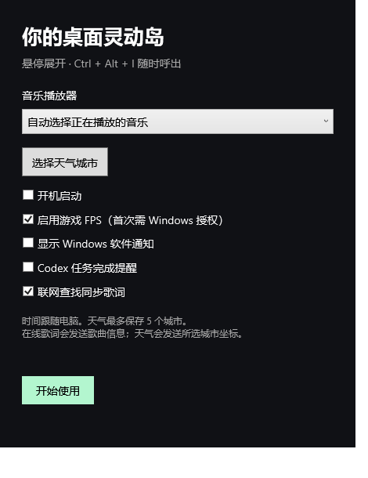

# Desktop Island · 桌面灵动岛

Windows 桌面顶部的小型悬浮工具：听歌看歌词，游戏看帧率，空闲看时间与天气。

## 下载使用

1. 在 **[Releases](../../releases/latest)** 下载 `DesktopIsland-1.3.0-win-x64.zip`。
2. **完整解压**到普通文件夹，双击 `Install.cmd` 安装并创建桌面快捷方式。也可以直接运行 `DesktopIsland.exe`。
3. 跟随首次引导选择音乐软件、天气城市和需要的功能。开启 FPS 时接受一次 Windows 授权，之后自动连接。

下载包自带 .NET 运行环境，不需要安装 SDK、申请 API Key 或修改音乐软件。源码页面的 **Code → Download ZIP** 是开发源码，普通使用请下载 Release 中的程序包。

**环境：Windows 11 / Windows 10 22H2，64 位 x64。** 界面主要使用中文。macOS、Linux 和 ARM64 不在本版支持范围内。



## 功能

| 场景 | 功能 |
| --- | --- |
| 音乐 | QQ 音乐或网易云音乐；当前和下一句同步歌词、封面、进度、播放/暂停、上下首 |
| 游戏 | 96 × 26 DIP 帧率胶囊，自动识别前台游戏、默认鼠标穿透 |
| 空闲 | 读取电脑本地时间；天气图标与当日最低/最高温 |
| 天气 | 自选城市/区县，最多保存 5 个地点；首次使用没有预设城市 |
| 计时 | 倒计时、秒表、暂停/恢复、重开程序后保留状态 |
| 提醒 | 可选 Windows 通知、Codex 完成提醒，以及其他 Agent 的本机通知入口 |
| 设置 | 开机启动、音乐来源、悬停速度、顶部距离、歌词偏移、游戏列表和功能开关 |

默认悬停 200ms 展开，移开收起。**Ctrl + Alt + I** 随时展开/收起；右键灵动岛或托盘图标可进入设置、退出。

## 音乐和游戏兼容性

- **QQ 音乐**：优先使用 Windows 系统媒体会话。请使用官方 Windows 桌面客户端，并先开始播放；部分版本需要开启播放器自己的系统媒体控制选项。
- **网易云音乐**：优先系统媒体会话；当前 3.x 客户端可回退到只读本地播放日志。回退控制使用系统媒体键，建议只运行一个音乐播放器。遇到其他媒体会话时会提示，避免错误控制另一款播放器。
- 在线歌词会按歌曲身份匹配，并保留本地缓存；可以导入 `.lrc`。没有匹配、纯音乐或接口不可用时显示歌名/歌手，不保证每首歌曲都有同步歌词。支持不同播放器版本的程度可能随其更新变化。
- FPS 使用独立进程读取 **DirectX / DXGI Present** 系统事件，不注入 DLL、不修改游戏、不改变游戏优先级。适用于通过 DXGI 提交画面的 Direct3D 游戏。窗口游戏可在设置中选择游戏 EXE；无边框全屏通常可自动识别。
- 使用**无边框全屏或窗口模式**。普通桌面置顶窗口不能保证覆盖独占全屏。Vulkan/OpenGL、云游戏及特殊反作弊环境不保证可用；无数据显示 `-- FPS`。此读数不等同于包含显卡插帧的最终显示帧率。
- 首次启用 FPS 需要当前 Windows 账户具备管理员权限并允许系统授权。标准账户仍可使用音乐、天气、时间和计时。监测存在少量资源开销，不承诺所有游戏零影响。

详细操作见 **[使用指南](docs/GETTING_STARTED.md)**、**[常见问题](docs/FAQ.md)**。解压后的 `使用说明.html` 可离线打开。

## 隐私

没有内置个人 API Key、账号、城市、设备编号或聊天记录。设置和缓存存放在当前用户的 `%LOCALAPPDATA%\DesktopIsland`，不在程序目录或仓库中。

Windows 通知与 Codex 监听默认关闭，需要自行启用。联网歌词发送歌曲信息，天气发送所选城市的坐标；无遥测或日志上传。完整说明见 **[隐私说明](docs/PRIVACY.md)**。

## 从源码构建

需要 Windows、.NET 10 SDK。制作完整下载包还需 Visual Studio / Build Tools 的“使用 C++ 的桌面开发”组件，用于小型快捷方式工具和验证程序。

```powershell
dotnet run --project tests/Island.Tests.csproj -c Release
powershell -ExecutionPolicy Bypass -File scripts/package.ps1
```

输出位于 `release/`。GitHub Actions 会执行构建与行为检查；发布 tag 后生成下载包。运行环境已包含在 Release 包中。

## 许可与参考

项目采用 [MIT](LICENSE)。使用或参考了 [kadrxy/Dynamic-Island](https://github.com/kadrxy/Dynamic-Island)、[netease-cloudmusic-detector](https://github.com/Coooookies/netease-cloudmusic-detector)、[QQMusicMonitor](https://github.com/GotKiCry/QQMusicMonitor) 和 [Microsoft TraceEvent](https://github.com/microsoft/perfview)。天气来自 [Open-Meteo](https://open-meteo.com/)。第三方声明见 [THIRD_PARTY_NOTICES.md](THIRD_PARTY_NOTICES.md)。
